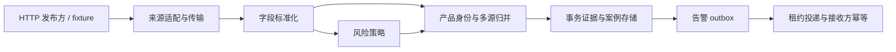

# 模块契约与一致性

## 数据流

## 发布方接入

`SourceAdapter.pull(cursor)` 返回一页 `SourceDocument` 和下一位置。HTTP 适配器支持两个真实不同的记录封装：

- `product-feed`：顶层 `records`；记录字段为 `id`、`sequence`、`published_at`、`product`。
- `recall-bulletin`：顶层 `bulletins`；记录字段为 `reference`、`position`、`issued_at`、`details`。

两个格式都用顶层 `next_cursor` 返回下一位置。位置必须单调递增且为正整数；适配器过滤已提交的重叠记录，拒绝倒退或无序页。每页最多 2000 条，HTTP 响应最多 2 MB，默认超时 10 秒。传输层只允许无内嵌账号密码的 HTTP/HTTPS 地址。

### 快照来源 `snapshot-feed`

第三种格式按代次提供完整快照，语义与上述两种增量格式完全不同，由 `SnapshotHttpSource` / `CollectionPipeline.collect_snapshot` 承载。无 `token` 查询参数的请求开启一代；响应为 `generation`（单调递增正整数）、`records`（记录封装沿用 `product-feed`，但 `sequence` 只在同一代内递增，换代后重置）和 `next_token`。`next_token` 是不可解析、不可比较的字符串，仅作为下一页请求的 `token` 参数原样回传；为 `null` 表示本代收齐。发布方以 HTTP 410 表示标记失效，传输层把状态码保留在 `TransportError.status_code`，接入层转成 `ContinuationExpired`。

进度分两层，互不混用：

- **可恢复的接收进度**：`snapshot_receptions`、`snapshot_pages`、`snapshot_records` 三张暂存表保存当前在收的代次、已收页（按请求标记记录页面内容哈希）和按代内序号落库的记录。中间页只写暂存区，绝不触碰 `raw_evidence`、`source_signals`、`cases`、`case_revisions` 或 outbox，因此正式案例看不到任何半代变更。
- **正式采集进度**：`source_state.applied_generation` 记录唯一已生效代次。整代收齐后，`RecallStore.apply_snapshot` 在一个 `BEGIN IMMEDIATE` 事务内比较并交换该列、流式处理暂存记录（每块 `APPLY_CHUNK_SIZE` 条，整代不进内存）、更新证据与案例、入队告警，成功后清空该代暂存区。任何一步失败都整体回滚。

恢复与竞争规则：

- 进程停在收页途中，重开后凭暂存的 `next_token` 续传；停在最后一页与正式提交之间，重开后识别 `complete` 暂存并直接完成切换，不重复建修订。
- 410 或翻页响应出现更高/不同代次时，未完成的旧代由 `abandon_snapshot_reception` 整体丢弃，状态为 `restarted`，下一轮无标记请求开启新代，旧代与新代不会混用。
- 同一标记重发相同页面：内容哈希一致，暂存幂等无变化；重发不同内容抛出 `SnapshotConflict`，该页被拒绝且原接收进度保留。
- 两个采集者竞争时，`apply_snapshot` 的代次比较并交换保证较旧代次与迟到的旧尝试得到 `StaleGeneration`（管线状态 `superseded`），不能覆盖已生效的新代。
- 快照只声明本代存在的记录：快照中未出现的旧记录继续保留，不视为撤回。
- 重复接收已生效的同一代：无标记响应的代次等于 `applied_generation` 时直接返回 `completed`，不产生修订或告警；代次倒退则按发布方异常处理。

增量来源的整数 `cursor` 列含义不变；`applied_generation` 仅对快照来源非空，老数据库通过 `ALTER TABLE` 平滑加列，既有游标与证据摘要保留原义，不需要清库。

网络获取发生在事务外。增量来源获取成功后，存储层对旧游标做比较并交换检查；竞争失败返回 `superseded`，不会覆盖其他 worker 的进度。整页错误不推进位置。网络错误按来源持久化指数退避，2 秒起步、上限 300 秒；快照的 410/换代属于可立即重试的预期轮换，不计失败退避。

测试入口：`tests/test_http.py`、`tests/test_collection.py`、`tests/test_snapshot.py`、`tests/test_snapshot_http.py`。

## 标准化与风险

标准化执行 Unicode NFKC、casefold、标点与空白归一，保留非拉丁文字。品牌、产品、市场、风险描述不能为空，时间必须包含时区。业务坏记录保存业务载荷和拒绝原因后与正常记录一起提交，因此不会永远堵住同一页。

`RiskPolicy` 有独立的规则、版本和 `RiskDecision` 接口。默认规则按词组边界匹配，显式发布方等级优先；无法识别的显式等级隔离处理。它是演示风险规则，不是监管或医学评级。当前案例保存合并等级与风险描述，`RiskDecision` 的解释接口可独立调用；案例中尚未持久化每条规则的解释。

测试入口：`tests/test_normalize.py`、`tests/test_risk.py`。

## 身份与归并

产品身份由标准化后的品牌、产品型号、市场三元组确定，使用结构化序列化避免分隔符碰撞。跨来源相同身份汇总最新来源声明，风险等级取最高，风险描述取有序并集，不随来源处理顺序而振荡。

当前不做模糊匹配，不猜测两个不同型号是否同物。发布方修正产品身份时，声明移动到新案例；原案例没有剩余声明时标为 inactive，历史保留。一个采集页先更新全部声明，再汇总受影响的案例，避免页内瞬时告警。

测试入口：`tests/test_normalize.py`、`tests/test_collection.py`。

## 事务边界与证据

`RecallStore.commit_batch` 在同一 SQLite 写事务中完成业务载荷留存、坏记录隔离、来源声明更新、案例修订、告警入队、游标推进。任何一步失败均回滚；重试不会出现游标已过但证据缺失的状态。

业务载荷是收到的来源 ID、来源记录 ID、发布时间和 payload 的规范 JSON，按 SHA-256 去重。它不等于完整 HTTP 报文存档。修订表示案例的合并业务状态变化；相同状态不制造新修订。原始业务证据和修订保存在 SQLite，不使用第二个文件存储来制造跨资源事务窗口。

SQLite 每个 worker 使用独立连接，WAL 与 `BEGIN IMMEDIATE` 保障写入串行化。基线使用单个 SQLite 文件，不声称支持分布式数据库或无限并发。

测试入口：`tests/test_collection.py` 的故障注入、竞争游标、重开数据库和完整性检查。

## 告警队列与投递

`Outbox.enqueue` 必须加入调用方现有事务，不能独立提交；队列按 `(case_key, revision)` 去重。`Outbox.claim` 原子领取到期任务，领取次数和唯一租约 ID 持久化。

状态流：`pending -> leased -> delivered`；失败回到 `pending` 并退避，租约到期可重新领取。确认与重试都检查租约 ID 和有效期，旧 worker 无法覆盖新 worker。派送器用实际发送完成时刻确认，避免慢请求误用领取时刻。

Webhook 始终携带同一案例修订的固定 `Idempotency-Key`。本地状态和远程接收无法形成原子事务，所以仅保证至少一次发送；远端幂等是安全重投的必要契约。进程内 `RecordingSink` 用于演示此契约。

测试入口：`tests/test_delivery.py`、`tests/test_http.py`。

## 模块演进约束

- 传输与发布方格式的变化通过 `SourceAdapter` 输出契约隔离。
- 产品身份与多来源归并保持在 `reconcile.py`，风险规则在 `risk.py`。
- 投递协议与队列租约分别位于 `alerts.py` 和 `outbox.py`，不放进采集管线。
- SQLite 的连接与事务辅助只有 `database.py`；它是共享基础设施，不是每个功能必须重写的业务模块。
- 根目录 CLI 只组装依赖，不承载业务判定。
